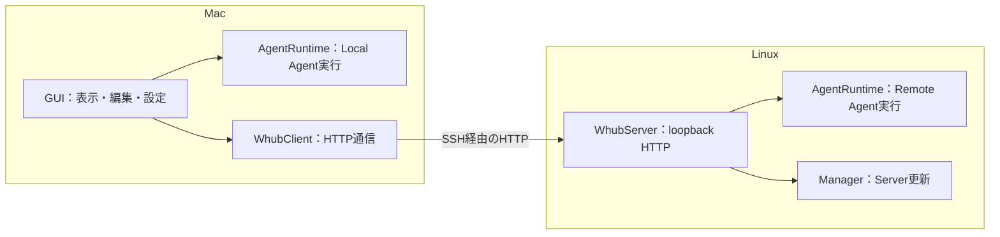

# MacとLinuxの責務

Macは操作画面と接続を担当し、Linuxはリモートのファイル操作・Agent実行・Server更新を担当する。Local AgentはMac内で実行する。

## 1. MacとLinuxの担当

| 場所 | 担当 |
| --- | --- |
| Mac GUI | UI、Host設定、SSH接続、HTTPクライアントの管理 |
| Mac内のAgentRuntime | Local Agentの実行と会話・実行状態の保持 |
| LinuxのWhubServer | Remote Agentの実行と会話・実行状態の保持、Server更新の受付・実行・履歴管理 |

## 2. 通信の経路

Agent応答はLocal,Remote共通のモデルを利用

## 3. Agent実行の所有者と寿命

Local／RemoteともWhubAgentの`AgentRuntime`が実行を所有する。LocalはMac GUIから直接呼び、RemoteはWhubClientとWhubServerを介して呼ぶ。

| 操作・事象 | Local Agent | Remote Agent |
| --- | --- | --- |
| タブを閉じる | sessionを終了する | 状態取得を終了し、Linux側の実行は継続する |
| SSH切断 | - | 実行を終了しない。Mac側は再接続後に状態を取得する |
| 実行を所有するプロセスの終了 | Macアプリ終了でsessionを失う | Server終了・再起動でsessionを失う |

## 4. dev／prodの選択

DevとProd2つのServerを持つ。これらはSwiftの Debug build と Archive build によってルーティングされる。